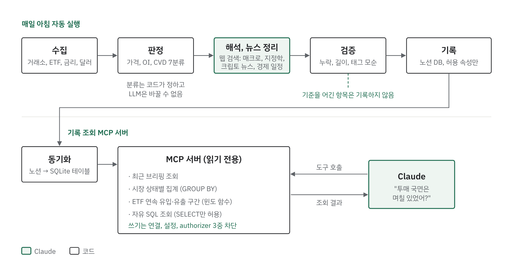

# Briefing Log MCP

[Market Briefing Agent](https://github.com/suipizza/market-briefing-agent)가 쌓은 브리핑 기록을 Claude가 SQL로 조회하는 읽기 전용 MCP 서버

**포트폴리오**: [suipizza.github.io/projects/briefing.html](https://suipizza.github.io/projects/briefing.html) (마켓 브리핑 에이전트와 한 프로젝트로 소개)

| 기간 | 형태 | 기술 |
|---|---|---|
| 2026.11 | 1인, Market Briefing Agent 확장 | Python, SQLite, MCP Python SDK, Notion API |

## 문제

- 브리핑 에이전트가 매일 한 페이지씩 기록을 남기지만, 기록이 쌓일수록 "어떤 시장 상태가 며칠 있었는지", "ETF 순유출이 며칠 이어졌는지"를 보려면 노션 페이지를 일일이 열어야 하는 불편함
- 기록을 SQL로 다룰 수 있게 정리하고, 그 SQL을 Claude가 안전하게 쓰도록 MCP로 연결

## 설계와 구현

- 노션 기록을 SQLite 테이블과 뷰로 동기화 (노션은 조회 API만 호출)
- 자주 쓰는 분석은 SQL 도구로 정의: GROUP BY 조건부 집계, 윈도 함수로 ETF 연속 유입·유출 구간 계산
- 나머지 질문은 Claude가 직접 SELECT를 작성하는 조회 도구로 제공, 스키마는 리소스로 공개
- 읽기 전용 연결, query_only, SQLite authorizer로 쓰기 동작 3중 차단



*전체 흐름. 아래 단이 이 저장소*

## 도구

| 도구 / 리소스 | 하는 일 | SQL 포인트 |
|---|---|---|
| `recent_briefings(days)` | 최근 N일 브리핑 | `ORDER BY ... LIMIT ?` |
| `state_summary(start, end)` | 시장 상태(CVD·OI 해석)별 일수, 평균 BTC·OI 변화, 평균 ETF 순유입 | `GROUP BY`, 조건부 집계 |
| `etf_flow_streaks()` | 수급이 확정된 날만으로 순유입/순유출 연속 구간 | 윈도 함수로 연속 구간 묶기(gaps and islands), 뷰 |
| `query_sql(sql)` | Claude가 직접 쓰는 자유 조회 | SELECT/WITH 한 문장만 |
| `briefing://schema` | 테이블·뷰 정의 | Claude가 SQL을 쓰기 전에 읽는다 |

## 안전장치

Claude가 SQL을 직접 쓰게 하는 만큼, 쓰기가 일어날 수 없게 세 겹으로 막았다.

1. **파일을 읽기 전용으로 연다** (`file:...?mode=ro`)
2. **`PRAGMA query_only = ON`** 으로 연결 수준에서 쓰기 금지
3. **SQLite authorizer**로 SELECT·READ·FUNCTION 외의 동작(INSERT, UPDATE, DELETE, ATTACH, PRAGMA 등)을 거절

여기에 `query_sql`은 SELECT/WITH로 시작하는 한 문장만 받고, 결과는 200행까지만 돌려준다. 노션 동기화도 조회(data source query) API만 호출한다. 이 동작은 테스트가 고정한다 (`DELETE`, `UPDATE`, `SELECT 1; DROP ...`, `WITH ... DELETE`, `ATTACH`, `PRAGMA` 모두 거절되고 행 수가 그대로인지 확인).

## 키 없이 돌려보기

저장소의 `data/sample_briefings.csv`는 실제 브리핑 12일치(2026-10-23 ~ 11-13)의 숫자·태그다.

```bash
python3 -m venv .venv && .venv/bin/pip install -e ".[dev]"   # Python 3.11 이상
.venv/bin/python -m briefing_mcp.load_sample   # CSV → data/briefings.db
.venv/bin/python -m briefing_mcp.demo          # MCP 클라이언트로 도구를 실제 호출
.venv/bin/python -m pytest -q                  # 12 passed
```

`demo` 출력 일부 ([전체](examples/demo_output.txt)):

```
## state_summary {}
{"state": "혼조", "days": 5, "avg_btc_chg_pct": -0.63, "avg_oi_chg_pct": -0.23, "avg_etf_flow_musd": -209.4, "weak_risk_days": 2}
{"state": "롱 청산 하락(투매)", "days": 3, "avg_btc_chg_pct": -4.26, "avg_oi_chg_pct": -1.75, "avg_etf_flow_musd": -309.2, "weak_risk_days": 3}
...
## etf_flow_streaks {}
{"dir": "유출", "start": "2026-11-02", "end": "2026-11-04", "days": 3, "total_musd": -1157.5}
...
## query_sql {"sql": "DELETE FROM briefings"}
거절: Error executing tool query_sql: 쿼리 거절: SELECT 또는 WITH로 시작하는 조회만 허용됩니다.
```

연속 구간은 DB에 기록이 있는 날 기준이다. 기록이 빠진 날(예: 10/27~29)이 있으면 그 사이는 이어서 세지 않는다.

## Claude에 연결하기

**Claude Code**

```bash
claude mcp add briefing-log -- /절대경로/briefing-log-mcp/.venv/bin/briefing-log-mcp
```

**Claude Desktop** (`claude_desktop_config.json`)

```json
{
  "mcpServers": {
    "briefing-log": {
      "command": "/절대경로/briefing-log-mcp/.venv/bin/briefing-log-mcp"
    }
  }
}
```

연결 후 물어볼 수 있는 것:
- "최근 5일 브리핑 요약해 줘" → `recent_briefings`
- "시장 상태별로 BTC가 평균 얼마나 움직였어?" → `state_summary`
- "ETF 순유출이 가장 길게 이어진 구간은?" → `etf_flow_streaks`
- "10년물이 하루에 10bp 넘게 오른 날 BTC는 어땠어?" → 스키마를 읽고 `query_sql`

## 실제 노션 데이터로 동기화

```bash
cp .env.example .env   # NOTION_TOKEN, NOTION_DATA_SOURCE_ID 입력 (읽기 권한만 준 integration 권장)
.venv/bin/python -m briefing_mcp.sync_notion
```

같은 날짜는 덮어쓴다(`INSERT ... ON CONFLICT(date) DO UPDATE`). 브리핑 에이전트가 ETF 잠정치를 다음 날 확정치로 고치면, 다시 동기화할 때 같이 반영된다.

## 파일

```
briefing_mcp/
  schema.sql       briefings 테이블, confirmed_flows 뷰
  db.py            SQLite 연결(쓰기용/읽기 전용), upsert
  sync_notion.py   노션 → SQLite (조회 API만)
  server.py        MCP 서버 (도구 4개, 리소스 1개, 안전장치)
  load_sample.py   샘플 CSV 적재
  demo.py          MCP 클라이언트로 도구 호출
tests/test_server.py   도구 결과, 쓰기 거절, 노션 변환 테스트
```
